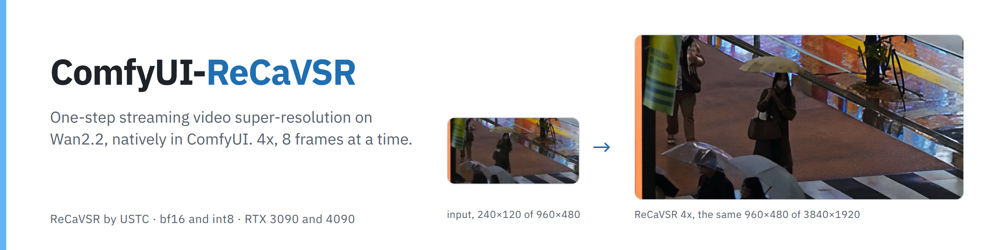
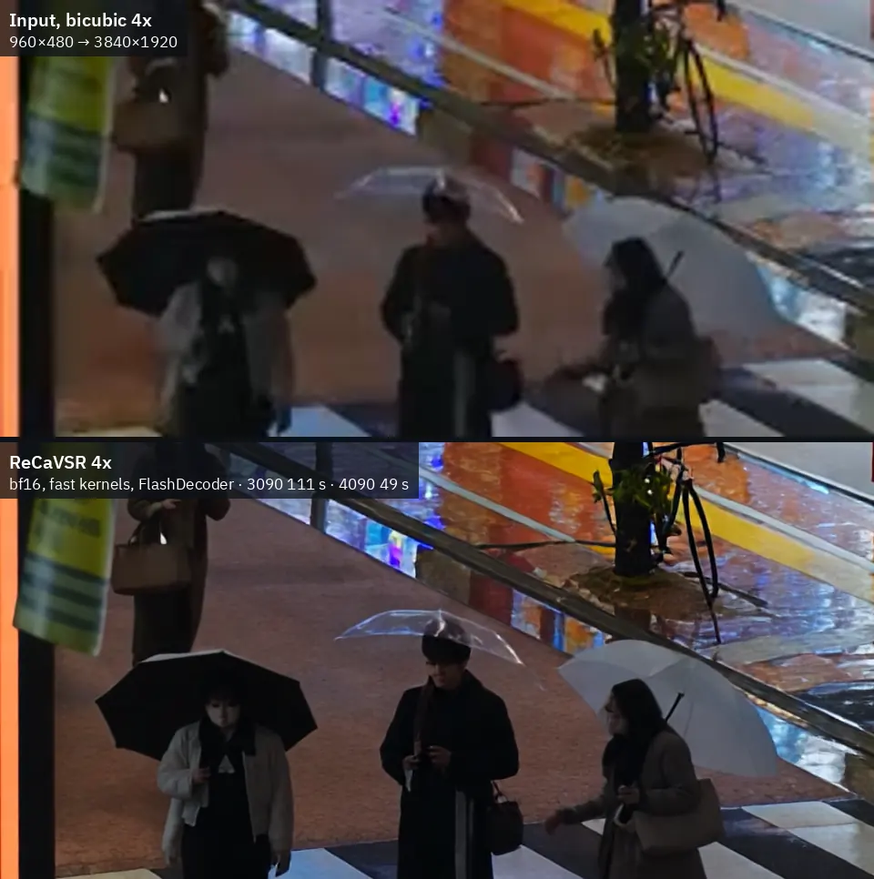
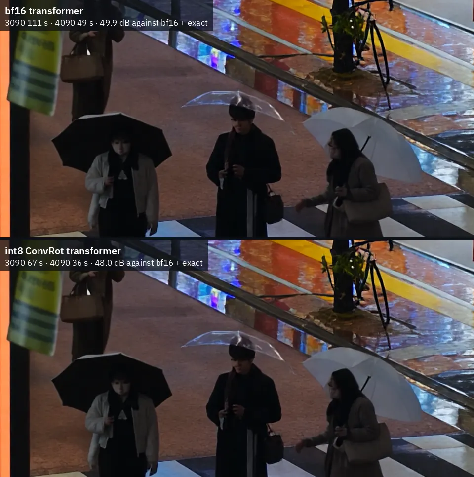
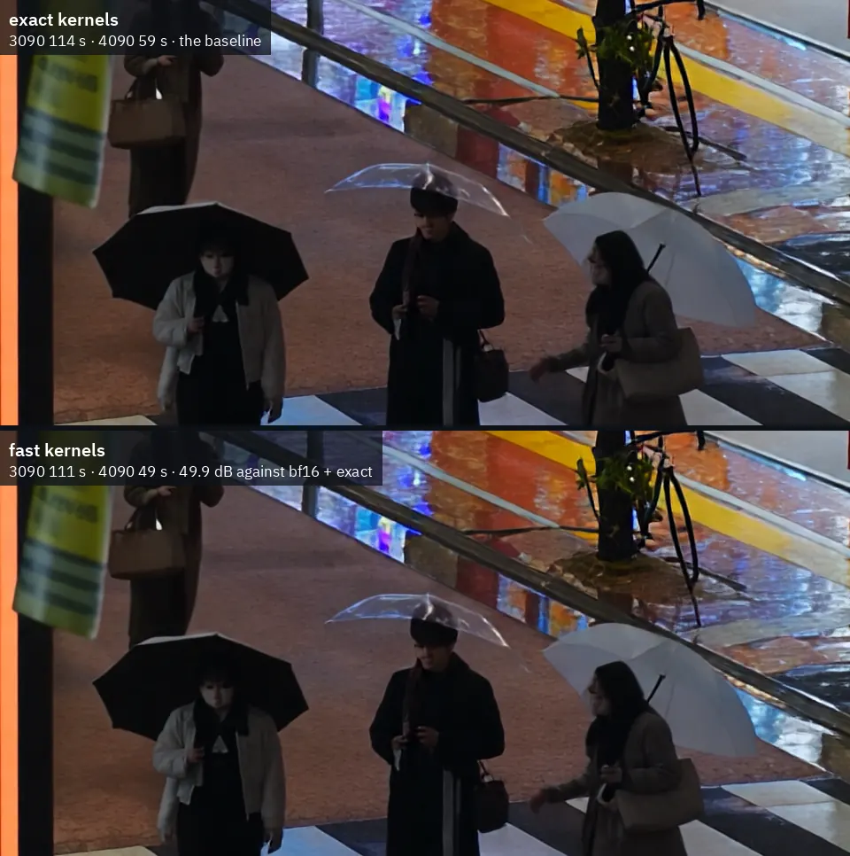

<picture>
  <source media="(prefers-color-scheme: dark)" srcset="assets/banner-dark.png">
  
</picture>

<p align="center">
  <a href="#requirements"></a>
  <a href="#smaller-cards-and-other-setups"></a>
  <a href="#quick-start"></a>
  <a href="#license-and-credits"></a>
</p>

<p align="center">
  <a href="#quick-start"></a>
  <a href="https://huggingface.co/PedroMarinhoDev/ReCaVSR-ComfyUI"></a>
  <a href="example_workflows"></a>
  <a href="https://github.com/kopperx/ReCaVSR"></a>
</p>

Run **[ReCaVSR](https://github.com/kopperx/ReCaVSR)** (USTC) **natively in ComfyUI**. ReCaVSR is a one-step streaming
diffusion video super-resolution model built on Wan2.2 TI2V-5B. It upscales a clip in blocks, 21 frames and then 8 at a
time, each in a single denoising step, reusing the previous block's latents and a cache of past keys and values. Its
own small decoder, FlashDecoder, turns each block into frames as soon as it is done, conditioned on the input. Here it
runs on ComfyUI's model and memory management; with the exact kernels it gives the reference's output bit for bit.

<table>
  <tr>
    <td width="50%" valign="top"></td>
    <td width="50%" valign="top"></td>
  </tr>
</table>

<sub>Crops at 1:1 of the 4x output, the input scaled bicubic for comparison · left: a rainy street, 960×480 → 3840×1920,
input on top · right: a portrait, 360×360 → 1440×1440, input on the left · clips from ReCaVSR's real-world demo set · bf16, fast kernels, FlashDecoder, seed 42, no colour fix · first 72 frames</sub>

<table>
  <tr>
    <td width="33%" valign="top"><br><b>Streaming, one step per block</b><br>21 frames, then 8 at a time, each decoded as soon as it is generated. A longer clip costs time, not memory.</td>
    <td width="33%" valign="top"><br><b>4x to 3840×1920 on 24 GB</b><br>149 frames of 960×480 in 36 s on an RTX 4090 and 67 s on an RTX 3090, with the int8 file.</td>
    <td width="33%" valign="top"><br><b>int8 ConvRot</b><br>6.3 GB instead of 10.6, and the transformer 1.8× faster, on both cards and both sizes.</td>
  </tr>
  <tr>
    <td valign="top"><br><b>FlashDecoder</b><br>The model's own, streaming decoder: 25 to 40× faster than the Wan 2.2 VAE and it fits at 4K. The VAE option draws finer texture when time allows.</td>
    <td valign="top"><br><b>The reference, bit for bit</b><br><code>exact</code> kernels reproduce ReCaVSR's own runtime on the same GPU; the faster default sits about 49 dB from it.</td>
    <td valign="top"><br><b>ComfyUI's memory management</b><br>Model patchers and dynamic VRAM: the weights stream when they don't fit, so 1440×1440 runs on an 8 GB card.</td>
  </tr>
</table>

## Quick start

1. **Install the nodes** and restart ComfyUI. Search for **ReCaVSR video super-resolution** in ComfyUI-Manager, or
   install it from the [Comfy Registry](https://registry.comfy.org/nodes/comfyui-recavsr) with
   `comfy node install comfyui-recavsr`. Or clone this repository into `custom_nodes` and install its two packages
   (Triton for the attention kernels, OpenCV for the reference's frame resize; both have fallbacks, see
   [Requirements](#requirements)).

   ```bash
   cd ComfyUI/custom_nodes
   git clone https://github.com/PedroMarinhoDev/ComfyUI-ReCaVSR
   pip install -r ComfyUI-ReCaVSR/requirements.txt
   ```

2. **Download the files** into `ComfyUI/models/recavsr`: one transformer, plus the prompt and the FlashDecoder.

   | File | Size | From |
   |---|---|---|
   | [transformer.safetensors](https://huggingface.co/kopper/ReCaVSR/blob/main/transformer.safetensors) (bf16) | 10.6 GB | [kopper/ReCaVSR](https://huggingface.co/kopper/ReCaVSR), as released |
   | **or** [transformer_int8_convrot.safetensors](https://huggingface.co/PedroMarinhoDev/ReCaVSR-ComfyUI/blob/main/recavsr/transformer_int8_convrot.safetensors) | 6.27 GB | [this project's Hugging Face page](https://huggingface.co/PedroMarinhoDev/ReCaVSR-ComfyUI) |
   | [prompt.safetensors](https://huggingface.co/kopper/ReCaVSR/blob/main/prompt.safetensors) | 4.2 MB | kopper/ReCaVSR |
   | [flashdecoder.safetensors](https://huggingface.co/kopper/ReCaVSR/blob/main/flashdecoder.safetensors) | 229 MB | kopper/ReCaVSR |

   ```bash
   cd ComfyUI/models
   hf download kopper/ReCaVSR prompt.safetensors flashdecoder.safetensors --local-dir recavsr
   # then the bf16 transformer
   hf download kopper/ReCaVSR transformer.safetensors --local-dir recavsr
   # or the int8 one
   hf download PedroMarinhoDev/ReCaVSR-ComfyUI recavsr/transformer_int8_convrot.safetensors --local-dir .
   ```

   The folder can also be set with `recavsr:` in `extra_model_paths.yaml`. The `vae` decoder option uses ComfyUI's
   own [wan2.2_vae.safetensors](https://huggingface.co/Comfy-Org/Wan_2.2_ComfyUI_Repackaged/blob/main/split_files/vae/wan2.2_vae.safetensors)
   in `models/vae`, not the `vae.safetensors` of kopper/ReCaVSR.

3. **Open the workflow and run.** In ComfyUI, **Templates → ComfyUI-ReCaVSR → recavsr_video_4x** (or drag
   [`example_workflows/recavsr_video_4x.json`](example_workflows/recavsr_video_4x.json) in), load your clip in **Load
   Video** and queue. The audio and frame rate pass through to **Save Video**.

**Scale 4 is what the model was trained for**; the reference also documents 2 and 1.5. Any size runs: sizes that are
not a multiple of 32 are padded for the model and cropped back.

## Speed

Two clips from ReCaVSR's real-world demo set at 4x, through a ComfyUI server per card: ComfyUI 0.44.0, PyTorch 2.14.1 with CUDA 13.2, sage attention,
dynamic VRAM, Linux. The time is the **ReCaVSR Upscale Video** node's: moving the models onto the GPU, every block, and
decoding and copying the frames out. Each setting ran after a 29-frame warm-up at the same size, so Triton's kernel
builds and reading the file from disk are not in it; writing the mp4 adds 5 to 15 s. PSNR is against bf16 + exact +
FlashDecoder on the same card, over every frame of the node's uint8 output.

**Rainy street**, 149 frames, 960×480 → 3840×1920

| Transformer | Kernels | Decoder | RTX 3090 | RTX 4090 | Peak VRAM 3090 / 4090 | PSNR |
|---|---|---|---|---|---|---|
| bf16 | exact | FlashDecoder | 114 s (1.3 fps) | 59 s (2.5 fps) | 23.2 / 22.6 GB | reference |
| bf16 | fast | FlashDecoder | 111 s (1.3 fps) | 49 s (3.0 fps) | 23.5 / 23.5 GB | 49.9 dB |
| int8 ConvRot | exact | FlashDecoder | 82 s (1.8 fps) | 47 s (3.2 fps) | 20.4 / 20.9 GB | 47.9 dB |
| int8 ConvRot | fast | FlashDecoder | 67 s (2.2 fps) | 36 s (4.2 fps) | 18.6 / 21.2 GB | 48.0 dB |
| bf16 | fast | Wan 2.2 VAE | 823 s (0.2 fps) | 417 s (0.4 fps) | 23.5 / 23.5 GB | 34.4 dB |

**Portrait**, 180 frames, 360×360 → 1440×1440

| Transformer | Kernels | Decoder | RTX 3090 | RTX 4090 | Peak VRAM 3090 / 4090 | PSNR |
|---|---|---|---|---|---|---|
| bf16 | exact | FlashDecoder | 40 s (4.5 fps) | 20 s (9.2 fps) | 15.6 / 16.1 GB | reference |
| bf16 | fast | FlashDecoder | 33 s (5.4 fps) | 17 s (10.6 fps) | 15.7 / 15.9 GB | 48.9 dB |
| int8 ConvRot | exact | FlashDecoder | 29 s (6.2 fps) | 16 s (11.1 fps) | 11.5 / 11.7 GB | 47.3 dB |
| int8 ConvRot | fast | FlashDecoder | 23 s (7.9 fps) | 15 s (12.0 fps) | 11.7 / 11.6 GB | 47.2 dB |
| bf16 | fast | Wan 2.2 VAE | 273 s (0.7 fps) | 119 s (1.5 fps) | 23.5 / 23.5 GB | 38.8 dB |

- Both cards ran at the same time on one machine and shared its CPU, which cost up to about 10%: alone, the RTX 3090
  ran the rainy street with bf16 and fast kernels in 101 s against the table's 111 s. Other repeats came within 1%
  (the RTX 3090 on the portrait) and 3% (the RTX 4090 on the rainy street), and one within 15% (the RTX 4090 on the
  portrait, right after the VAE runs had moved the weights out of VRAM).
- Peak VRAM is what nvidia-smi showed. Dynamic VRAM keeps as much of the weights on the card as fits, so it shows use,
  not the minimum. At 3840×1920 the activations alone are about 18 GB: the bf16 transformer then streams part of its
  weights every block, which is why `fast` gains little there on the RTX 3090.
- The VAE row is bf16 with fast kernels: its time hardly depends on the transformer settings (all four on the portrait: 116 to
  119 s on the RTX 4090). At 1440×1440 on the RTX 3090 the plain VAE decode sits at the edge of 24 GB, and one run fell
  back to tiling (455 s); at 3840×1920 it always tiles.

## Comparisons

Each pair is the same crop at 1:1 from the two settings, the first 72 frames; the decoder pair is a 2x zoom (nearest
neighbour) of half that crop, since its difference is finer than the webp's own compression at 1:1. The captions give the node's time on each
card and the PSNR against bf16 + exact + FlashDecoder.

### bf16 or int8

The int8 ConvRot file is 6.27 GB instead of 10.6 and needs about 4 GB less VRAM. With the fast kernels it runs the
transformer 1.75 to 1.8 times as fast on both cards and both sizes. The whole node gains less, because decoding and
copying the frames out don't change: 1.7× on the RTX 3090 and 1.4× on the RTX 4090 at 3840×1920, 1.5× and 1.1× at
1440×1440. It lands 47 to 48 dB from bf16, as sharp, with differences only in the finest texture.

<table>
  <tr>
    <td width="50%" valign="top"></td>
    <td width="50%" valign="top"></td>
  </tr>
</table>

### FlashDecoder or the Wan 2.2 VAE

FlashDecoder is ReCaVSR's own decoder: a small transformer, conditioned on the input frames, that decodes each block as
soon as it is generated. `decoder` `vae` instead decodes every latent at the end with ComfyUI's stock Wan 2.2 VAE.
**The VAE draws finer texture**: hair strands, the jacket's weave and skin come out crisper, with 23% more edge
energy (mean Laplacian of the luma) than FlashDecoder on the portrait, and 8% on the rainy street, where it ranges from
none on the large signs to 26% on the people under the umbrellas. The two are 38.8 dB (portrait) and 34.4 dB (rainy
street) apart. The softness is the decoder's own:
these nodes reproduce ReCaVSR's FlashDecoder bit for bit (see [Checked against the reference](#requirements)).

The VAE takes 25 to 40 times as long to decode and needs the whole video at once. On the RTX 4090 at 1440×1440 the node
takes 119 s against 17 s (decoding alone 105 s against 4 s). At 3840×1920 the VAE doesn't fit in 24 GB and falls back to
ComfyUI's tiled decode: 417 s against 49 s (378 s against 12 s). FlashDecoder is the one for speed and streaming; the
VAE is for when the last bit of texture is worth minutes per clip.

<table>
  <tr>
    <td width="50%" valign="top"></td>
    <td width="50%" valign="top"></td>
  </tr>
</table>

### Fast or exact kernels

`kernels` `fast`, the default, runs comfy-kitchen's fused norm, RoPE and residual kernels and retuned attention tiles;
`exact` is the reference's sequence of operations, bit for bit its output. `fast` lands at 49 to 50 dB against `exact`,
below anything visible, and takes 7 to 24% off the node's time. The exception is bf16 at 3840×1920 on the RTX 3090
(3%), where streaming the weights takes the time.

<table>
  <tr>
    <td width="50%" valign="top"></td>
    <td width="50%" valign="top"></td>
  </tr>
</table>

## Smaller cards and other setups

**Smaller cards.** The node tells ComfyUI how much room its activations need, about 2.6 MB per 32×32 tile of the output
(5 GB at 1440×1440, 18 GB at 3840×1920), and dynamic VRAM streams the weights that don't fit beside them. On the RTX
3090 with 12 or 16 GiB held by another process, so that ComfyUI had a 12 GB or an 8 GB card, the portrait at 4x
(1440×1440, 180 frames, fast kernels, FlashDecoder) took:

| | 24 GB | 12 GB | 8 GB |
|---|---|---|---|
| int8 | 23 s | 23 s | 27 s |
| int8 + `kv_offload` | | 27 s | 29 s |
| bf16 | 33 s | 35 s | 39 s |
| bf16 + `kv_offload` | | 38 s | 41 s |

**`kv_offload`** keeps the attention history (66 latent planes over the 30 blocks, about 0.8 MB per output token: 1.6 GB
at 1440×1440, 5.8 GB at 3840×1920) in RAM between blocks and uploads it for each one. The output is the same, bit for
bit. At 1440×1440 it wasn't needed and cost 7 to 16%; it is for outputs whose activations don't fit on the card at all,
such as 3840×1920 on a 16 GB card (18 GB of activations, about 12.5 GB with it; not measured).

**Without Triton** (common on Windows installs), both attention kernels fall back to PyTorch: 64 queries at a time
against every visible key, with the window as a mask, through ComfyUI's attention. On the RTX 3090 it matches the
kernels to within 1e-3 on values around 0.02; it is many times slower (not timed end to end).

**Without OpenCV**, the frames are resized with PyTorch's bilinear filter instead of the reference's OpenCV one: at most
one grey level off, 0.08 on average.

comfy-kitchen's kernels (`adaln`, `apply_rope1`, `window_attention`, the int8 GEMM) all have eager versions, so the fast
kernels and the int8 file load on any GPU; where ComfyUI has no int8 GEMM it dequantizes the weights. The CPU runs the
code paths but is not a target.

## The nodes

| Node | What it does |
|---|---|
| **ReCaVSR Model Loader** | `transformer` picks the DiT file in `models/recavsr`, bf16 or int8; `prompt.safetensors` and `flashdecoder.safetensors` are read from the same folder. The weights wait in RAM until a run. |
| **ReCaVSR Upscale Video** | IMAGE frames in, IMAGE frames out. The terminal shows each stage, a progress bar with every block's transformer and decode time, and a summary with the frame rate. |

**ReCaVSR Upscale Video**'s inputs:

| Input | |
|---|---|
| `scale` | Output size = input size × scale, each side rounded half up. 4 is what the model was trained for. |
| `color_fix` | `none`, `adain` (each frame's mean and variance matched to the input) or `wavelet` (the input's low frequencies under the output's detail), StableSR's corrections. |
| `seed` | The one-step noise. |
| `decoder` | `flashdecoder`, the model's own, streaming; or `vae`, the Wan 2.2 VAE connected to the optional `vae` input, decoded at the end. |
| `kernels` | `fast` (default) or `exact`, above. |
| `kv_offload` | Keeps the attention history in RAM between blocks instead of VRAM, for cards the output size doesn't fit. Off by default. |

## Requirements

| | Tested |
|---|---|
| ComfyUI | 0.44.0 |
| GPU | RTX 3090 and RTX 4090, 24 GB each. Attention: sage |
| PyTorch | 2.14.1 with CUDA 13.2, Linux |
| Python packages | `triton` for the two attention kernels and `opencv-python-headless` for the reference's frame resize (`requirements.txt`). Both are optional, see [Smaller cards and other setups](#smaller-cards-and-other-setups) |

- **int8** runs comfy-kitchen's int8 GEMM, which needs an NVIDIA GPU of compute capability 7.5 or newer (RTX 20 series
  up). Elsewhere ComfyUI dequantizes the weights, which saves memory but not time.
- **`kernels` fast** uses comfy-kitchen's `adaln` and `apply_rope1`, and for the decoder its `window_attention`, which
  needs compute capability 8.0 (RTX 30 series up). All of them have eager versions, so fast mode loads anywhere.

<details>
<summary><b>Checked against the reference</b></summary>

`tests/parity.py` replays a capture of ReCaVSR's own runtime (its input blocks, noise and latents) through the nodes. On
the same GPU (RTX 3090, PyTorch 2.14) with `exact` kernels, every latent, every decoded frame and the final uint8 and
wavelet-corrected frames are identical, bit for bit, for:

- 31 frames at 2x (976×1660, padded to 992×1664): the Triton windowed-attention path;
- 101 frames at 1x (488×830): the full-grid attention path, the rolling RoPE window and the anchor cache.

Two things move the result off bit-exactness: ComfyUI's attention backend for the 512-token cross-attention (xformers
and sage differ from PyTorch SDPA by one bf16 ulp; the final frames then differ by half a grey level on average), and
a different GPU architecture. The reference's speed without `torch.compile` is what `exact` runs at.
</details>

<details>
<summary><b>Where the time goes, and what was tried</b></summary>

Profile of one bf16 exact body step at 2x (1.1 s of GPU time on the RTX 3090): bf16 GEMMs 52% (feed-forward 29%,
attention projections 23%), the FlashDecoder 16% (half of it its own attention kernel), the Triton self-attention 12%,
the two LQ convolutions 8%, and about 16% in unfused float32 casts, norms, modulation and residual adds. After int8 and
the fast kernels (0.57 s): self-attention 21%, FlashDecoder 24%, LQ convolutions 16%, int8 GEMMs 16% plus 3% activation
quantization.

What `fast` does (each measured on its own; each differs from exact by one bf16 rounding step):

- the transformer's three norm + modulation steps per block and the head through comfy-kitchen's `adaln` (8× faster
  per call; the modulation is bf16 instead of float32);
- the spatial RoPE through `apply_rope1` (10×), in the transformer and for the decoder's queries (the decoder's
  cached keys stay float32: rounding them first cost 1.3 dB);
- the gated residual adds in the output projections' epilogues (`addcmul`, or the int8 GEMM's fused residual);
- the self-attention kernel with 8×8×2 query tiles and 8 warps instead of 4×8×2 and 4 (−18%);
- the decoder's refinement kernel with 4×8 query tiles instead of 4×16 (−48%), and its backbone attention through
  comfy-kitchen's `window_attention` (−44%).

Measured and not used:

- torch.compile: on the exact math, compiling every block was slower than the fused kernels, took 30 s per process and
  graph-broke on ComfyUI's op internals; on the fused kernels it fails on the `adaln` custom op; with int8 weights it
  cannot trace the GEMM.
- comfy-kitchen's `na3d` for the self-attention: 20% faster for the first block, which has no history, 3× slower for
  every later one, because it computes queries for the history planes too.
- an int8 FlashDecoder: 11% faster decoder, 3.7 dB lost.
- `fp16_conv3d`, cuDNN's benchmark and channels-last modes, and an unfold + GEMM formulation for the LQ convolutions:
  all slower than cuDNN's bf16 implicit GEMM.
- fp8 weights: ConvRot int8 is both faster (4× the bf16 rate on the RTX 4090, 2.9× on the RTX 3090) and more accurate
  (0.96% weight error) than per-tensor fp8.
- TensorRT, assessed and not built: the time is in GEMMs that already run cuBLAS/cutlass kernels and in two custom
  Triton kernels that an engine would need as plugins, and the streaming history makes every block a different shape.
</details>

<details>
<summary><b>Building the int8 file yourself</b></summary>

```bash
python custom_nodes/ComfyUI-ReCaVSR/tools/convert_int8.py ComfyUI/models/recavsr/transformer.safetensors
```

It writes `transformer_int8_convrot.safetensors` in about a minute on a GPU: the 30 blocks' self-attention,
cross-attention query and output, and feed-forward weights as int8 with a scale per output row and a 256-wide block
Hadamard rotation (ComfyUI's int8 ConvRot format, run by comfy-kitchen's int8 GEMM with per-token activation
quantization and the feed-forward's GELU fused into the second GEMM's input). The patch embedding, LQ projection,
conditioning, cross-attention keys and values (computed once per video), norms and head stay bf16. Mean relative weight
error 0.96%.
</details>

## Troubleshooting

<details>
<summary><b>Out of memory at large output sizes</b></summary>

The activations grow with the output size: about 2.6 MB per 32×32 output tile, 18 GB at 3840×1920. ComfyUI streams
the weights by itself when they don't fit beside them; when the activations alone don't fit, turn on `kv_offload` or
lower `scale`. See [Smaller cards](#smaller-cards-and-other-setups).
</details>

<details>
<summary><b><code>decoder</code> <code>vae</code> is very slow</b></summary>

That is the Wan 2.2 VAE decoding the whole video at the end, minutes at these sizes, tiled when it doesn't fit (see
[the comparison](#flashdecoder-or-the-wan-22-vae)). FlashDecoder decodes 25 to 40 times faster, a little softer.
</details>

<details>
<summary><b>The first run is slow</b></summary>

Triton builds the attention kernels for each output size on first use, 10 to 30 s; they are cached on disk after that.
Reading the 10.6 GB transformer from disk the first time depends on the drive.
</details>

## License and credits

The code of this pack: GPL-3.0 (`LICENSE`), like ComfyUI. The model code ported from ReCaVSR's runtime
(`recavsr/attention.py`, `cache.py`, `dit.py`, `flashdecoder.py` and `session.py`, with ReCaVSR's two Triton attention
kernels) stays under Apache-2.0 (`LICENSE-APACHE`); `NOTICE` lists it. ReCaVSR is by Xijun Wang, Xin Li, Suhang Yao,
Zirui Lang, Bingchen Li and Zhibo Chen, University of Science and Technology of China
([code](https://github.com/kopperx/ReCaVSR), [project page](https://kopperx.github.io/ReCaVSR/),
[paper](https://arxiv.org/abs/2609.37831)). Its transformer is Wan2.2 TI2V-5B (Alibaba Wan team, Apache-2.0) with
ReCaVSR's adapters merged in. [kopper/ReCaVSR](https://huggingface.co/kopper/ReCaVSR) states no licence for the weights;
the int8 file on Hugging Face is converted from them and follows their terms. The two sample clips are inputs 021 and
009 of ReCaVSR's real-world demo set ([anonyaa/ReCaVSR](https://huggingface.co/anonyaa/ReCaVSR)). Colour correction
follows [StableSR](https://github.com/IceClear/StableSR).

```bibtex
@misc{wang2026recavsronestepstreamingdiffusion,
  title={ReCaVSR: One-Step Streaming Diffusion Video Super-Resolution with Recycled Latents and Learned Cache Routing},
  author={Xijun Wang and Xin Li and Suhang Yao and Zirui Lang and Bingchen Li and Zhibo Chen},
  year={2026},
  eprint={2609.37831},
  archivePrefix={arXiv},
  primaryClass={cs.CV},
  url={https://arxiv.org/abs/2609.37831}
}
```
